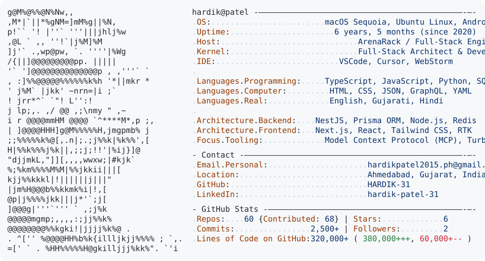

  <a href="https://github.com/HARDIK-31">
    <picture>
      <source media="(prefers-color-scheme: dark)" srcset="https://raw.githubusercontent.com/HARDIK-31/HARDIK-31/master/dark_mode.svg">
      
    </picture>
  </a>

  

  
  
  
  

---

### 👨‍💻 About Me

I am a **Full-Stack Software Engineer & Architect** based in India, specializing in high-performance web applications, resilient backend architectures, and developer-focused tooling. My engineering mindset focuses on clean code, domain-driven design, and building scalable systems with polished, intuitive user interfaces.

- 🔭 **Current Focus:** Architecting enterprise multi-tenant SaaS platforms (NestJS + Prisma + Next.js Turborepo monorepos).
- 🤖 **AI & Developer Tooling:** Building Model Context Protocol (MCP) servers and agentic workflows.
- ⚡ **Engineering Principles:** Strict typing, bulletproof RBAC & tenancy isolation, structured JSON logging, and modular architecture.
- 💬 **Ask me about:** TypeScript, NestJS, Next.js App Router, Prisma ORM, Redis caching & queues, PostgreSQL tuning, and Chrome Extensions.
- 📫 **How to reach me:** [hardikpatel2015.ph@gmail.com](mailto:hardikpatel2015.ph@gmail.com)

---

### 🛠️ Tech Stack & Capabilities

<table>
  <tr>
    <td align="center" width="140"><strong>Languages</strong></td>
    <td>
      
    </td>
  </tr>
  <tr>
    <td align="center" width="140"><strong>Backend & APIs</strong></td>
    <td>
      
      &nbsp;<code>REST APIs</code> &nbsp;<code>WebSockets</code> &nbsp;<code>BullMQ</code> &nbsp;<code>JWT / RBAC</code>
    </td>
  </tr>
  <tr>
    <td align="center" width="140"><strong>Frontend & UI</strong></td>
    <td>
      
      &nbsp;<code>RTK Query</code> &nbsp;<code>Radix UI</code> &nbsp;<code>Turborepo</code>
    </td>
  </tr>
  <tr>
    <td align="center" width="140"><strong>Databases & Caching</strong></td>
    <td>
      
    </td>
  </tr>
  <tr>
    <td align="center" width="140"><strong>DevOps & Tooling</strong></td>
    <td>
      
      &nbsp;<code>PM2</code> &nbsp;<code>Nginx</code> &nbsp;<code>ESLint</code>
    </td>
  </tr>
</table>

---

### 🚀 Featured Highlights & Projects

<table>
  <tr>
    <td width="50%" valign="top">
      <h4>🤖 <a href="https://github.com/HARDIK-31/docs-assistant-mcp">Docs Assistant MCP</a></h4>
      
An AI-powered <strong>Model Context Protocol (MCP) server</strong> that empowers developers and AI agents to generate, analyze, search, and maintain project documentation seamlessly.

      
<code>TypeScript</code> · <code>MCP SDK</code> · <code>AI Tooling</code>

    </td>
    <td width="50%" valign="top">
      <h4>🏢 <a href="https://github.com/HARDIK-31/play-hub-monorepo">PlayHub / ArenaRack SaaS</a></h4>
      
Comprehensive enterprise monorepo featuring a <strong>NestJS + Prisma</strong> backend and multiple <strong>Next.js</strong> frontends with multi-tenancy, dynamic reports (PDF/Excel), RBAC, and real-time gaming session tracking.

      
<code>Turborepo</code> · <code>NestJS</code> · <code>Next.js</code> · <code>PostgreSQL</code> · <code>Redis</code>

    </td>
  </tr>
  <tr>
    <td width="50%" valign="top">
      <h4>🛡️ <a href="https://github.com/HARDIK-31/Whatsapp-Web-Privacy-Shield">WhatsApp Web Privacy Shield</a></h4>
      
A React & TypeScript Chrome extension that protects screen privacy by selectively blurring chats, sensitive media, and contacts until hovered or revealed.

      
<code>React</code> · <code>TypeScript</code> · <code>Chrome Extensions API</code>

    </td>
    <td width="50%" valign="top">
      <h4>📦 <a href="https://github.com/HARDIK-31/Node-TS-Boilerplate">Production Node & TS Boilerplates</a></h4>
      
Developer-ready backend boilerplates featuring modern TypeScript, Docker support, Winston/Pino logging, Swagger API documentation, GraphQL, and Git hooks.

      
<code>Node.js</code> · <code>TypeScript</code> · <code>Docker</code> · <code>Swagger</code>

    </td>
  </tr>
</table>

---

### 📊 GitHub Statistics

  
  

---

  

